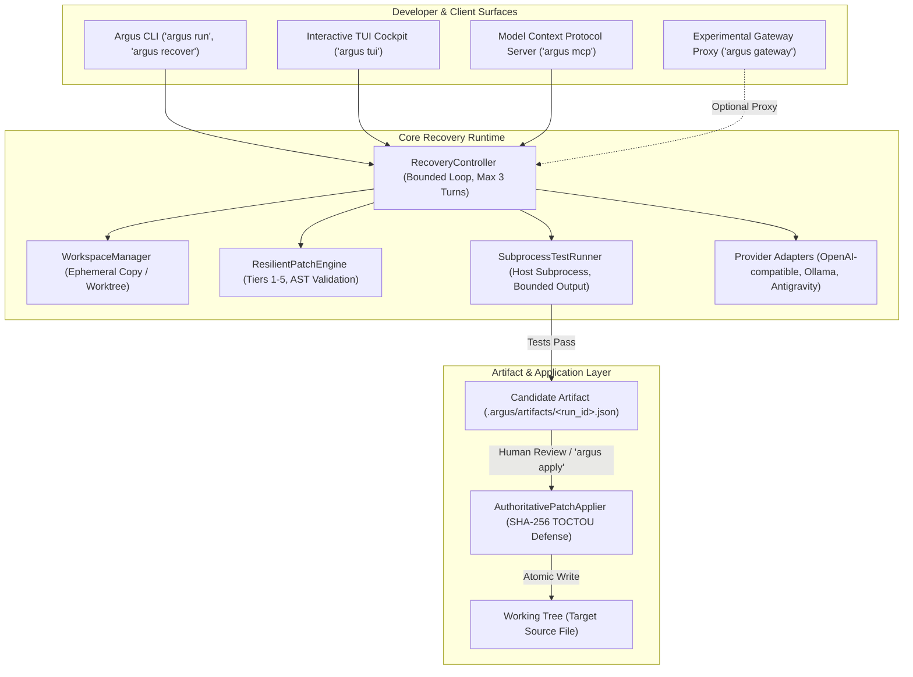

# Argus — Local AI-Assisted Code Recovery Runtime

Argus is an open-source, local AI-assisted code recovery runtime designed to repair broken, malformed, or misapplied code edits generated by Large Language Models (LLMs) and autonomous coding agents.

Argus operates beneath developer editors, terminals, and agent workflows. It isolates failing tests, reconciles patch formatting differences using a multi-tier matching engine, executes test suites in ephemeral copies of the workspace, and produces cryptographically verified candidate artifacts before any changes touch the user's working tree.

---

## 1. What Argus Is (and Is Not)

- **Argus is:**
  - A local runtime for bounded, test-gated code repair.
  - A multi-tier fuzzy patch reconciler with syntax validation.
  - An isolated workspace executor for reproduction test commands.
  - A candidate artifact generator with SHA-256 provenance and atomic application.
  - A local Model Context Protocol (FastMCP) server and experimental gateway proxy.

- **Argus is NOT:**
  - An AI foundation model or LLM provider.
  - An autonomous open-ended coding agent that makes unguided changes.
  - A general-purpose conversational chatbot.
  - A cloud-hosted SaaS platform.
  - A security sandbox for running untrusted arbitrary code on the host.

---

## 2. The Problem It Solves

AI coding tools frequently generate patches that fail to apply or introduce immediate test regressions:
1. **Search-Block Mismatches:** Slight discrepancies in leading indentation, trailing whitespace, or blank lines cause standard `diff` or `git apply` tools to reject the patch entirely.
2. **Hallucinated or Ambiguous Replacements:** Models often guess code context or emit search targets that match multiple locations, corrupting the wrong function when applied naively.
3. **Working Tree Corruption:** Conventional agents write edits directly into the developer's live working directory. If the generated code is broken, tests fail, uncommitted developer work is contaminated, and manual cleanup is required.
4. **Runaway Inference Loops:** When an edit fails, naive agent loops repeatedly query expensive models without bounded turn constraints or token budget ceilings, exhausting API quotas.

---

## 3. Why Code Recovery Matters

Automated code generation is only as valuable as its reliability. When an agent generates 90% correct code with a 10% whitespace or context mismatch, traditional patch engines fail closed with an error, discarding the entire generation. Conversely, overly permissive patchers silently modify the wrong file regions.

Argus introduces an engineering compromise: **resilient, syntax-validated patch reconciliation gated behind executable test verification**. If a patch can be reconciled and passes the existing test suite in an isolated workspace, it is preserved as an inspectable candidate artifact. If it cannot be unambiguously matched or fails verification, it is safely refused.

---

## 4. Architecture



---

## 5. How Recovery Works

When invoked (via `argus run "<test_command>"`, `argus recover`, or MCP):

1. **Workspace Virtualization:** [`WorkspaceManager`](file:///c:/coding/Argus/argus/runtime/workspace.py) creates an ephemeral copy of the project in the system temporary directory (or an isolated Git worktree). The developer's live working tree is untouched.
2. **Reproduction Execution:** [`SubprocessTestRunner`](file:///c:/coding/Argus/argus/runtime/runner.py) executes the test command in the isolated workspace, capturing failure exit codes and traceback frames.
3. **Target Localization:** The failure traceback is parsed to identify the target source file and symbol.
4. **Inference & Patch Generation:** The configured provider adapter generates a search/replace patch block based on the error context.
5. **Multi-Tier Patch Reconciliation:** The [`ResilientPatchEngine`](file:///c:/coding/Argus/argus/patch/fuzzy_engine.py) matches the search block against the target file using progressive fallback tiers with mandatory AST validation.
6. **Isolated Verification:** The candidate patch is applied inside the ephemeral workspace, and the reproduction test suite is re-executed.
7. **Artifact Generation:** Upon test passage, a cryptographic candidate artifact is written to `.argus/artifacts/<run_id>.json` containing baseline and candidate SHA-256 hashes, diff summaries, and test telemetry.
8. **Explicit Application:** The working tree is only updated when the user explicitly runs `argus apply <run_id>` or triggers approval via TUI / MCP.

---

## 6. The Matching Tiers

The Argus patch engine operates five progressive tiers. Each tier has strict boundaries:

| Tier | Name | Description | Default Status |
|---|---|---|---|
| **Tier 1** | **Exact Matching** | Byte-for-byte exact character match of the search block against the source file. | **Active** |
| **Tier 2** | **Whitespace & Indentation Normalization** | Normalizes leading indentation and trailing line whitespace to reconcile formatting shifts while preserving semantic structure. | **Active** |
| **Tier 3** | **Fuzzy Sliding-Window Matching** | Character-level sliding-window similarity matching (default threshold 0.82) with an ambiguity margin check (0.10) to reject multiple ambiguous matches. | **Active** |
| **Tier 4** | **Anchor-Based Matching** | Matches surrounding prefix and suffix code anchors when intermediate lines have drifted. | **Disabled by default** (Requires explicit `--enable-tier4` opt-in) |
| **Tier 5** | **Safe Refusal** | **Not a matching algorithm.** When all active tiers fail or multiple candidate locations match equally, Argus refuses to modify the code. | **Terminal Fallback** |

All successful matches in Tiers 1–4 must parse into a valid Abstract Syntax Tree (`ast.parse`) before acceptance.

---

## 7. Installation

Argus is designed for local developer installation from source.

### Prerequisites
- Python 3.11, 3.12, 3.13, or 3.14.
- Git (for repository detection and worktree support).

### Installation from Source

```bash
# 1. Clone the repository
git clone https://github.com/argus-org/argus.git
cd argus

# 2. Create and activate a virtual environment
python -m venv .venv
# On POSIX / Linux / macOS:
source .venv/bin/activate
# On Windows (PowerShell):
.venv\Scripts\Activate.ps1

# 3. Install core recovery runtime in editable mode
pip install -e .

# Optional: Install auxiliary components (interactive TUI cockpit and Gateway proxy)
pip install -e ".[tui,gateway]"
```

*Note: Argus is currently in pre-release development. Do not attempt to install from unpublished public package indexes.*

---

## 8. Configuration

Argus looks for an optional `argus.yaml` file in your repository root, or reads environment variables:

```yaml
# argus.yaml
provider: openai
model: gpt-4o
similarity_threshold: 0.82
ambiguity_margin: 0.10
test_timeout_seconds: 30
max_turns: 3
enable_tier4: false  # Experimental anchor matching (disabled by default)

# Optional Gateway Configuration
gateway:
  host: 127.0.0.1
  port: 8000
  budget:
    per_task_usd: 0.10
    per_session_usd: 1.00
    on_exhausted: fail_fast
```

### Environment Variables
- `ARGUS_GATEWAY_API_KEY`: Required secret key to start and access the experimental Gateway proxy.
- `OPENAI_API_KEY`: API key for OpenAI-compatible providers.
- `ANTHROPIC_API_KEY`: API key for Anthropic providers.

---

## 9. Provider Integrations

Argus supports explicit, authorized model providers:

1. **OpenAI-Compatible Endpoints:** Any standard OpenAI-compatible API (OpenAI, DeepSeek, self-hosted vLLM).
2. **Local Runtimes:** Local models running via Ollama (`http://localhost:11434/v1`).
3. **Antigravity Host Adapter:** Direct integration with Google Antigravity developer tooling via local CLI sessions.

### Provider Restrictions
> [!IMPORTANT]
> **Groq Prohibition:** Groq is strictly prohibited across all of Argus. The runtime, router, CLI, and configuration loaders reject Groq provider presets, endpoints (`api.groq.com`), and key signatures (`gsk_*`) to prevent unmetered rate-limit failures and maintain reproducible benchmark conditions.

---

## 10. Basic Usage

### Running Test-Gated Recovery
Execute a test command and initiate automatic recovery if it fails:

```bash
argus run "pytest tests/test_calculator.py"
```

### Targeted File Recovery
Run recovery targeting a specific file and reproduction test:

```bash
argus recover --target src/calculator.py --test "pytest tests/test_calculator.py"
```

### Reviewing and Applying Candidates
List available verified recovery candidates and apply an approved patch:

```bash
# Inspect generated candidate artifacts
argus candidates

# Inspect diff for candidate artifact
argus diff <run_id>

# Apply the approved candidate to your working copy
argus apply <run_id>
```

### Interactive Terminal Cockpit (TUI)
Launch the keyboard-driven terminal cockpit for real-time recovery monitoring:

```bash
argus tui
```

### FastMCP Server for Upstream Agents
Expose Argus capabilities (recovery, inspection, candidate application) to Claude Code, Cursor, or IDE extensions:

```bash
argus mcp
```

### In-Place Package Updates
Check for and apply updates to `argus-recovery` directly from PyPI:

```bash
# Check if a new release is available without installing
argus update --check

# Upgrade using detected package manager (uv, pipx, or pip)
argus update

# Include pre-release and beta builds
argus update --pre

# Explicitly specify package manager and bypass confirmation
argus update --method uv --yes
```

---

## 11. Approval & Application Semantics

To protect developer repositories, candidate patches are never applied automatically by default:
- **Integrity Verification:** Each candidate artifact records the SHA-256 hash of the target file before modification (`baseline_sha256`) and after modification (`candidate_sha256`).
- **TOCTOU Defense:** When [`AuthoritativePatchApplier`](file:///c:/coding/Argus/argus/patch/applier.py) executes, it verifies that the file on disk matches `baseline_sha256`. If the file was edited concurrently, the operation is refused without modifying the file.
- **Atomic File Updates:** Edits are written to a temporary sibling file and committed using `os.replace` to prevent partial file writes.

---

## 12. Security Model & Execution Boundaries

> [!WARNING]
> **Host Privileges Notice:**
> When running `SubprocessTestRunner` on the host, reproduction test commands execute with your **current local user privileges**. Workspace copying isolates repository files against accidental Git state changes, but it is **not** an OS sandbox or container boundary.

Key Security Properties:
- **No Silent Fallback:** If container isolation is requested (`--container`), Argus will fail closed if Docker is not available. It will **never** silently execute untrusted code on the host.
- **Subprocess Argument Validation:** Test commands are tokenized using strict security policies. Shell chaining operators (`&&`, `||`, `;`, `|`), backgrounding (`&`), and redirection (`>`, `<`) are strictly rejected. `shell=True` is never used.
- **Credential Redaction:** Sensitive environment variables (`OPENAI_API_KEY`, `ANTHROPIC_API_KEY`, tokens, passwords) are scrubbed before subprocess launch, and error tracebacks are sanitized.
- **Gateway Isolation:** The experimental Gateway binds to loopback (`127.0.0.1`) by default, validates `Host` headers against DNS rebinding, restricts CORS to loopback origins, enforces mandatory Bearer token authentication, and tracks rate limits across authenticated client identities.

---

## 13. Limitations

- **Language Scope:** Resilient patch application with AST syntax validation is currently implemented and tested for **Python** source files (`.py`). Non-Python source recovery is deferred to future releases.
- **Single-File Scope:** Argus currently reconciles and verifies **single-file** patches. Multi-file patch sets are rejected to prevent partial repository inconsistencies.
- **Experimental Gateway:** The reverse proxy Gateway (`argus gateway`) is experimental and separate from the default offline CLI recovery loop.
- **No Universal Correctness:** Passing an automated test suite proves that the candidate satisfies existing test assertions; it does not constitute a mathematical guarantee that the code is free of semantic bugs.

---

## 14. Testing & Verification

Argus includes a comprehensive offline test suite:

```bash
# Run core security and isolation gates
pytest tests/test_runtime_and_workspace_safety.py tests/test_gateway_security.py tests/test_wp6_deep_verification.py tests/test_wp7_deep_verification.py

# Run the 500-case synthetic adversarial patch corpus
pytest -v tests/test_patch_adversarial_corpus.py

# Run the full offline test suite
pytest -q --ignore=tests/test_real_host_integration.py
```

*Results from the latest test pass: 471 tests passed in the offline suite; 121 tests passed across three expanded core gate runs; 500 synthetic adversarial cases verified with 0 incorrect applications.*

---

## 15. Roadmap

- **Multi-Language AST Support:** Tree-sitter integration for TypeScript, JavaScript, Rust, and Go patch validation.
- **MicroVM Sandboxing:** Optional lightweight microVM integration (Firecracker / gVisor) for secure untrusted code evaluation.
- **Multi-File Transactional Patches:** Two-phase commit protocol for verified multi-file patch application.
- **Enhanced Diagnostics:** Integration with static analysis tools (Ruff, Pyright) during candidate validation.

---

## 16. Contributing & Community

Contributions are welcome! Please read:
- [`CONTRIBUTING.md`](CONTRIBUTING.md) for development setup, coding standards, and test guidelines.
- [`SECURITY.md`](SECURITY.md) for vulnerability reporting procedures and threat boundaries.
- [`CODE_OF_CONDUCT.md`](CODE_OF_CONDUCT.md) for community participation guidelines.

---

## License

Argus is released under the [MIT License](LICENSE).
