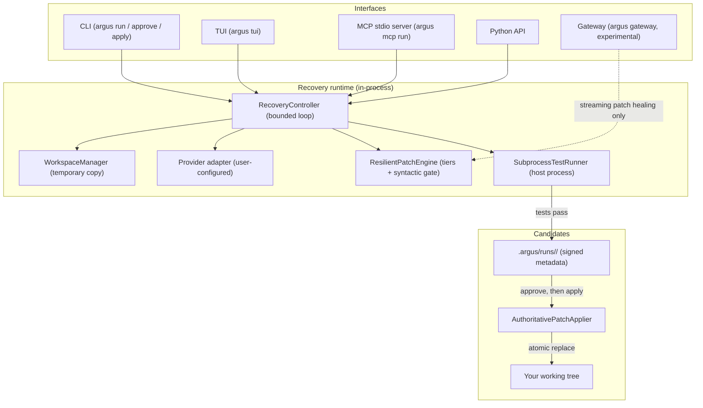
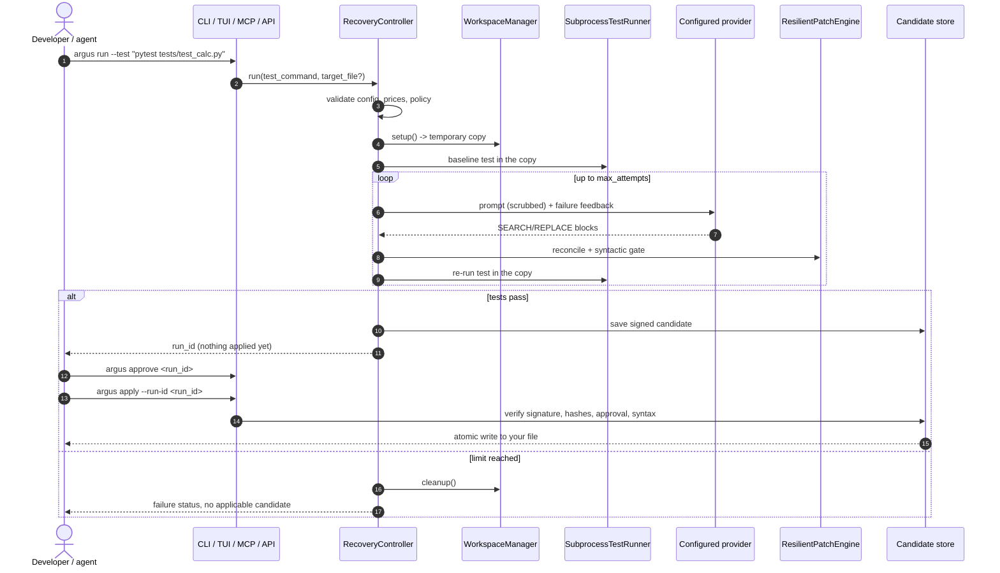

# Argus Architecture & Execution Design

**Status:** current implementation (post audit remediation).
**Scope:** recovery controller, patch engine, temporary workspaces, subprocess supervision, candidate artifacts, and the CLI / TUI / MCP / gateway surfaces.

---

## 1. Overview

Argus separates one **recovery runtime** from several thin **interfaces**. The CLI, TUI, MCP server and Python API all call the same `RecoveryController`; none has its own recovery logic.

---

## 2. Components

### RecoveryController (`argus/runtime/controller.py`)
- Owns the bounded loop: localize target, run the baseline test, ask the model for an edit, reconcile it, re-run the test in the copy, repeat until pass or a limit is hit.
- Limits: attempts (`max_attempts`, default 3, ceiling in `argus.config`), a per-run budget (`budget_limit_usd`, default `$0.03`), per-test and task timeouts, a token cap.
- **Model dispatch:** `ArgusConfig` resolves the model ladder once. A named model is pinned for every attempt. With no model named and a provider in `CASCADE_LADDERS` (openai, deepseek, gemini, antigravity) and escalation on, attempts 1-2 use the cheaper model and attempt 3 the stronger. The ladder and its source are recorded in `outcome.routing_reasons`. The adapter's reported model is recorded per attempt.
- **Cost safety:** unknown model prices fail closed (`UnpricedModelError` -> `CONFIG_ERROR`) unless the provider is local or host-native; a reservation is made before each call and settled after; uncertain spend is quarantined.
- **Project policy:** `argus.yaml` / `.argus.yaml` / `[tool.argus]` in the workspace root is applied to a per-run config copy and can only tighten limits. Notes land in `outcome.config_notes`.
- **Errors are typed outcomes**, not tracebacks: `CONFIG_ERROR`, `INVALID_TARGET`, `LOCALIZATION_FAILED`, `BUDGET_EXCEEDED`, `DEADLINE_EXCEEDED`, `PROVIDER_RATE_LIMITED`, `CONTAINER_SETUP_ERROR`, `TEST_SETUP_ERROR`, `ALREADY_PASSING`, `FAILED_MAX_ATTEMPTS`, `CANCELLED`, `SUCCESS`.
- Writes `attempts.json` next to the artifacts: per attempt, the patch tier, model, tokens, cost, finish reason and outcome flags.

### ResilientPatchEngine (`argus/patch/fuzzy_engine.py`, `parser.py`, `ast_checker.py`, `textio.py`)
- Parses SEARCH/REPLACE blocks as a line state machine; a truncated or malformed block is reported, never merged.
- Tiers: (1) exact at a line/token boundary; (2) whitespace/indentation-normalized whole lines; (3) token-equal region (whitespace/comments may differ, tokens may not); (4) experimental anchors, off by default; (5) refusal. Ambiguity (multiple candidates) is always refused.
- The result must pass a syntactic gate (`ast.parse` + `compile`) for `.py`, `.pyi`, `.pyw` files. The gate is syntactic only.
- `textio` decodes strictly (UTF-8, BOM, PEP 263), normalizes line endings for matching and restores the original endings on write.

### WorkspaceManager (`argus/runtime/workspace.py`)
- Creates a temporary **copy** under `argus_ws_*` in the system temp directory. Snapshot = Git-tracked plus untracked-not-ignored files (working-tree content) or a full walk for non-Git directories. Excludes `.git`, `.argus`, `__pycache__`, and root-level `.venv venv node_modules .tox .nox` and tool caches. Options: `snapshot_exclude`, `snapshot_respect_gitignore`, `snapshot_max_bytes` (default 2 GiB, fail fast).
- Symlinks are copied only if they stay inside the project.
- Cleanup removes the copy on exit; a session file (PID plus process start time) lets later runs prune leaked copies safely. A hard kill can still leave a copy until the next prune.
- There is no worktree mode.

### SubprocessTestRunner (`argus/runtime/runner.py`)
- Runs the test command without a shell, rejecting shell operators. Drains stdout/stderr concurrently into a 4 MB bounded collector; kills the process tree on timeout.
- **Runs on the host with the user's permissions; this is not a sandbox.** `HOST_EXECUTION_WARNING` is shown by the CLI before `argus run` and included in MCP payloads.

### Candidate store and applier (`argus/runtime/candidate.py`)
- Run IDs are validated against a strict pattern; only real child directories of `.argus/runs` resolve.
- Metadata is written with an HMAC-SHA256 signature (`metadata.sig`) using a key in the user config directory (never inside the workspace). Unsigned or altered metadata -> `CANDIDATE_SIGNATURE_INVALID`.
- Apply checks: verified, approved, signature, candidate hash, baseline hash against the live file, path containment, syntax, single apply per run (`.apply.lock`), then atomic replace preserving file mode. A repeat apply reports "already applied".

### Provider adapters (`argus/providers/`)
- `OpenAICompatibleAdapter` serves OpenAI, DeepSeek, Gemini (OpenAI-compatible endpoint), OpenRouter, Ollama, LM Studio and custom endpoints. `AntigravityHostAdapter` drives the local `agy` CLI. There is no separate Ollama adapter and no native Anthropic adapter.
- Credentials: OS keyring (service name overridable with `ARGUS_KEYRING_SERVICE`) with a 0600 fallback file; the `ARGUS_API_KEY` environment fallback applies to the `custom` provider only. Secrets are excluded from `repr`.
- Text sent to the model passes `scrub_prompt` (known keys, token-shaped secrets, PEM blocks); logs and artifacts use `scrub_secrets`.
- Groq is refused.

### Interfaces
- **CLI** (`argus/cli.py`): see the README; every command exits non-zero on error.
- **TUI** (`argus/tui/`, `tui` extra): same controller and candidate store.
- **MCP server** (`argus/mcp/server.py`): four tools, no approval tool; workspace confined to the server root; budget capped.
- **Gateway** (`argus/gateway/`, `gateway` extra): loopback proxy; outside the recovery loop.
- **Container evaluator** (`argus/runtime/container.py`): library-level only; `--network=none`, resource limits; opt-in via `use_container_runner`.

---

## 3. Execution flow

---

## 4. Not in the architecture

Earlier documents described an adaptive or learned router, execution-state feature vectors and embedding retrieval. None of that is in the shipped runtime. The evidence did not justify a learned router; see [RESEARCH_STATUS.md](RESEARCH_STATUS.md).
