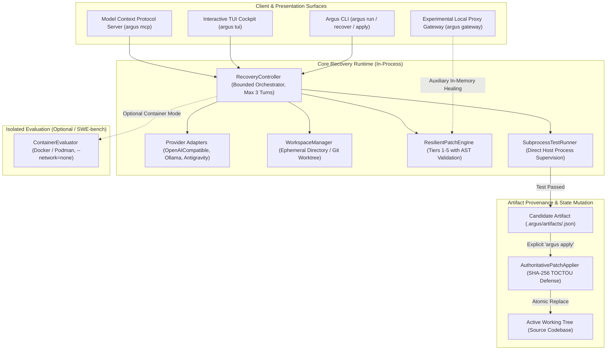
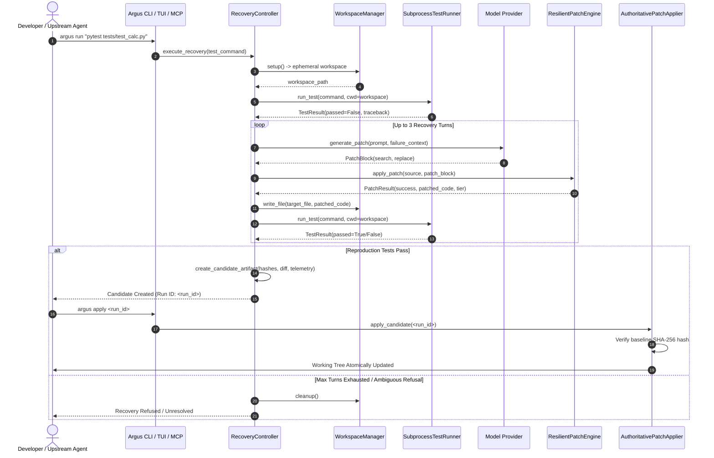

# Argus Architecture & Execution Design

**Status:** Current Implementation Architecture  
**Scope:** Core Recovery Runtime, Multi-Tier Patch Engine, Ephemeral Workspaces, Subprocess Supervision, Artifact Provenance, Interfaces (CLI, TUI, FastMCP, Gateway)

---

## 1. Architectural Overview & Boundary Separation

Argus is designed with a strict separation between its **Core Recovery Runtime** and its **Interface Layers**:

---

## 2. Component Inventory

### A. RecoveryController (`argus/runtime/controller.py`)
- **Role:** Central in-process orchestrator managing the bounded test-feedback loop.
- **Turn Bounds:** Hard-capped at 3 iterations (`max_turns=3`) to prevent runaway loops.
- **Lifecycle Management:** Implements `close()` and context manager protocol (`__enter__` / `__exit__`), deterministically terminating underlying adapter connections and HTTP connection pools.
- **Target Localization:** Automatically localizes the target failure file from reproduction traceback frames if not explicitly specified.

### B. ResilientPatchEngine (`argus/patch/fuzzy_engine.py`)
- **Role:** Syntax-validated multi-tier search-and-replace reconciler.
- **Tiers:**
  1. *Tier 1 (Exact Matching):* Byte-for-byte character match.
  2. *Tier 2 (Whitespace/Indentation Normalization):* Reconciles leading indentation and trailing space shifts while preserving relative indentation structure.
  3. *Tier 3 (Fuzzy Sliding-Window Matching):* Sliding-window character similarity with a strict threshold (`similarity_threshold=0.82`) and ambiguity rejection margin (`ambiguity_margin=0.10`).
  4. *Tier 4 (Anchor-Based Matching):* Surrounding anchor line matching for drifted interiors. Disabled by default; requires explicit opt-in (`--enable-tier4`).
  5. *Tier 5 (Safe Refusal):* Refusal mechanism. When matching is ambiguous or score is insufficient, Argus refuses to modify code.
- **AST Syntax Guard:** Mandatory Python Abstract Syntax Tree validation (`ast.parse`) on all candidates before acceptance.

### C. WorkspaceManager (`argus/runtime/workspace.py`)
- **Role:** Filesystem virtualization protecting the active working tree from contamination.
- **Copy Mode:** Creates full isolated project copy under `%TEMP%/argus_ws_*`, excluding heavy and non-essential directories (`.git`, `node_modules`, `venv`, `build`, `dist`).
- **Worktree Mode:** Uses detached Git worktrees (`git worktree add --detach`) with timeouts ($30\text{s}$) and automatic overlay of uncommitted modifications.
- **Session-Aware GC:** Writes `.argus_session.json` recording PID and process start-time (`kernel32.GetProcessTimes` on Windows, `/proc/{pid}/stat` field 22 on POSIX). Protects active runs against PID reuse and uses atomic rename claiming to prevent concurrent GC collisions.

### D. SubprocessTestRunner (`argus/runtime/runner.py`)
- **Role:** Execution harness for reproduction test suites on the host.
- **Argument Security:** Strict tokenization; rejects shell chaining (`&&`, `||`, `;`), redirection (`>`, `<`), and backgrounding (`&`). `shell=True` is prohibited.
- **Bounded Output Capture:** [`BoundedOutputCollector`](file:///c:/coding/Argus/argus/runtime/runner.py#L32) drains stdout and stderr concurrently in 64KB chunks to prevent pipe deadlocks, capping memory buffers at 4MB while preserving head and tail logs.
- **Process-Tree Termination:** Hard-kills runaway processes and all descendant worker processes on timeout via `taskkill /F /T` (Windows) or `os.killpg` (POSIX).

### E. AuthoritativePatchApplier (`argus/patch/applier.py`)
- **Role:** State mutation boundary.
- **Artifact Provenance:** Reads candidate artifacts from `.argus/artifacts/<run_id>.json`.
- **TOCTOU Defense:** Re-computes target file SHA-256 on disk; refuses application if file hash has changed since candidate generation.
- **Atomic Application:** Writes candidate content to a temporary sibling file and commits atomically via `os.replace`.

### F. Provider Adapters (`argus/providers/`)
- **Role:** Encapsulates communication with authorized model endpoints.
- **Supported Adapters:**
  - `OpenAICompatibleAdapter`: Standard OpenAI-compatible API protocol.
  - `OllamaAdapter`: Local offline inference runtime.
  - `AntigravityHostAdapter`: Integration with local Antigravity CLI paired programming sessions.
- **Prohibitions:** Groq endpoints and keys are strictly prohibited and refused.
- **Secret Redaction:** Scrubbing patterns redact API keys, tokens, and authorization material from logs, environments, and errors.

---

## 3. End-to-End Execution Flow

---

## 4. Auxiliary Interfaces (Optional Integrations)

### FastMCP Server (`argus/mcp/server.py`)
- Standard Model Context Protocol stdio interface allowing upstream agents (Claude Code, Cursor, OpenCode) to call `argus_status`, `argus_recover`, `argus_get_candidate`, and `argus_apply_candidate`.

### Experimental Gateway Proxy (`argus/gateway/server.py`)
- Auxiliary reverse proxy translating OpenAI/Anthropic API calls to configured backends with dynamic budget reservation (integer micro-dollars), loopback Host/Origin validation, identity-based rate limiting, and in-memory streaming patch healing.
- Strictly decoupled from core recovery execution.
