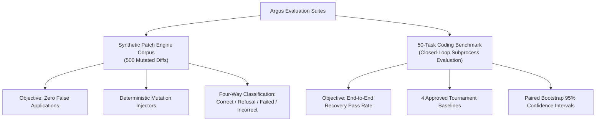

# Argus Benchmark Methodology and Research Validation

This document formalizes the evaluation framework, statistical methodology, baseline definitions, oracle criteria, and threat analysis for the Argus code recovery runtime.

---

## 1. Overview and Core Separation

Evaluation in Argus is partitioned into two distinct, non-overlapping empirical regimes:



1. **Synthetic Adversarial Patch Corpus (500 cases):** Focuses strictly on patch engine precision, tier dispatching, whitespace/indentation normalization, and safe refusal under ambiguity or multi-file targets.
2. **50-Task Coding Benchmark Tournament (200 problem runs):** Evaluates real LLM code generation and feedback-driven recovery in an isolated subprocess execution harness across 4 frozen baselines.

---

## 2. The Four Approved Tournament Baselines

To rigorously measure the value of closed-loop recovery against simpler mitigation strategies, Argus defines four standardized baselines evaluated on identical tasks under identical resource limits:

### Baseline A: `zero_shot_baseline`
- **Mechanism:** Direct prompt issued to the primary model (`gemini-3.8-flash-low`).
- **Attempts:** Exactly 1 attempt ($N = 1$).
- **Feedback:** None. If tests fail or the code raises an error, the task terminates immediately as failed.
- **Purpose:** Establishes the lower bound of raw model zero-shot capability on the benchmark dataset.

### Baseline B: `context_only_baseline`
- **Mechanism:** Exemplar-augmented prompt (few-shot context retrieved via AST similarity) issued to the model.
- **Attempts:** Exactly 1 attempt ($N = 1$).
- **Feedback:** None.
- **Purpose:** Measures the impact of static upfront context without iterative repair or execution feedback.

### Baseline C: `parallel_sampling_baseline` (Best-of-N)
- **Mechanism:** Repeated independent sampling up to 3 attempts ($N \le 3$) at temperature $T > 0$.
- **Attempts:** Up to 3 independent attempts. If attempt 1 fails, attempt 2 is generated from scratch with no traceback or error diagnostic.
- **Feedback:** None. The model has no visibility into why prior attempts failed.
- **Purpose:** Disentangles simple stochastic resampling benefits from feedback-guided diagnosis.

### Baseline D: `argus_closed_loop_recovery` (Full Argus)
- **Mechanism:** Closed-loop recovery runtime.
- **Attempts:** Up to 3 attempts ($N \le 3$).
- **Feedback:** Execution tracebacks, failed assertion line numbers, and error classifications (`assertion_error`, `runtime_error`, `syntax_error`) are extracted from the isolated subprocess test runner and structured into diagnostic repair prompts.
- **Escalation:** Can dynamically escalate to `gemini-3.8-flash-medium` when heuristic thresholds detect stubborn or complex failures.
- **Purpose:** Measures the net recovery gain of iterative error feedback and tier-based patch reconciliation.

---

## 3. False-Application Oracle & Classification

In automated code recovery, **incorrect application is strictly worse than refusal**. Applying an incorrect patch corrupts repository state, introduces subtle regressions, and breaks developer trust.

Argus classifies every patch application into one of four mutually exclusive terminal categories:

| Classification | Definition | Oracle Requirement | Argus Criterion |
| :--- | :--- | :--- | :--- |
| **Correct Recovery** | Patch was accepted and cleanly applied to the target region; resulting code matches ground truth. | AST / significant-line exact match with expected output. | Required for passing tasks. |
| **Safe Refusal** | Patch was recognized as ambiguous, multi-file, or unmatchable, and safely rejected without file mutation. | Engine returned `success=False` with `RefusalReason` (`AMBIGUOUS_MATCH`, `MULTI_FILE_UNSUPPORTED`, `NO_MATCH_FOUND`). | Required under drift/conflict. |
| **Failed Recovery** | Patch applied or refused, but execution tests still failed to pass within attempt budget. | Runner exited with non-zero code or failed assertions. | Acceptable terminal outcome. |
| **Incorrect Application** | Patch was applied to the wrong line, applied mismatched content, or mangled indentation/syntax. | Resulting source differs from ground truth, or introduced unintended mutations. | **STRICTLY FORBIDDEN (0 allowed)**. |

### Significant-Line Oracle

For the synthetic corpus, verification uses the significant-line oracle:
```python
def _significant_lines(text: str) -> list[str]:
    return [line.rstrip() for line in text.splitlines() if line.strip()]
```
Trailing whitespace differences and blank-line insertions are tolerated if and only if semantic indentation is preserved. If indentation or statements diverge, the case is marked as an **Incorrect Application**.

### Python AST Syntax Validation Scope

Python AST checks in Argus use standard library `ast.parse`:
- **Syntactic Parseability Only:** AST validation confirms that the candidate source code forms a valid Python syntax tree without `SyntaxError`.
- **No Semantic Guarantee:** AST validation does **not** evaluate types, variable scopes, runtime behavior, or mathematical correctness.
- **Not a Security Sandbox:** Checking AST parseability does not detect malicious code or sandbox execution.

---

## 4. Statistical Methodology: Paired Non-Parametric Bootstrap

To evaluate whether performance deltas between Argus and the baselines are statistically significant rather than artifacts of a 50-task sample, we compute paired non-parametric bootstrap confidence intervals:

1. **Paired Observation:** For each task $i \in \{1, \dots, 50\}$, observe binary outcomes $X_i \in \{0, 1\}$ (Argus) and $Y_i \in \{0, 1\}$ (Baseline).
2. **Delta Metric:** Compute sample pass rate difference $\Delta = \frac{1}{n}\sum_{i=1}^n (X_i - Y_i)$.
3. **Resampling:** Draw $B = 10,000$ bootstrap replicates with replacement from the paired sample index $\{1, \dots, n\}$.
4. **Bootstrap Statistic:** For each replicate $b$, compute $\Delta^{(b)} = \bar{X}^{(b)} - \bar{Y}^{(b)}$.
5. **Confidence Interval:** Compute the 95% percentile confidence interval:
   $$\text{CI}_{95\%} = [\Delta_{(\alpha/2)}, \Delta_{(1 - \alpha/2)}] = [\Delta_{(250)}, \Delta_{(9750)}]$$

### Uncertainty Distinction: Task Bootstrap vs. Model Variability vs. Repetitions

It is essential to distinguish the three tiers of uncertainty:

1. **Task-Bootstrap Uncertainty (Reported Here):** The 10,000 bootstrap resamples are drawn across the 50 tasks from the **single frozen tournament run**. This measures sample uncertainty over the task distribution within that specific run.
2. **Run-to-Run Model Variability (Unmeasured):** Generative language models exhibit stochastic variation across independent queries. A second full run of 50 tasks would yield slightly different attempt outcomes.
3. **Single Tournament Execution:** Exactly **ONE** tournament execution (50 tasks $\times$ 4 strategies = 200 problem runs, 216 total attempts) was performed. The 10,000 bootstrap iterations represent computational resampling of that single run, **not** 10,000 independent model invocations or multiple tournament repetitions.

---

## 5. Honest Accounting & Efficiency Trade-Off

Argus does not misrepresent compute utilization:

1. **Reliability vs. Efficiency Trade-Off:**
   - **More Tokens than Single-Shot:** Argus uses **+17.3% more tokens** than zero-shot (10,490 vs 8,944) and **+17.6% more tokens** than context-only (10,490 vs 8,921). Single-shot baselines fail immediately upon the first error, consuming zero repair compute. Argus expends compute on up to two additional turns to recover solutions.
   - **Slightly Fewer Tokens than Blind Sampling:** Argus uses **-1.0% fewer tokens** than parallel sampling (10,490 vs 10,596), because diagnostic feedback helps it converge in fewer average attempts (1.14 vs 1.18) when fixes are achievable.
   - **Higher Latency:** Argus exhibits higher average wall-clock latency (4,032 ms vs 3,484 ms for zero-shot) due to multi-turn round-trips, traceback parsing, and test re-execution.
2. **Metered API Spend:** Direct billed spend was `$0.00` because runs utilized an authenticated local Antigravity host adapter session backed by an active account subscription. This is **not free compute**; it utilizes subscriber quotas (RPM/TPM) and host CPU/memory.
3. **Gateway Estimates:** The Argus Gateway's cost estimators calculate hypothetical third-party proxy charges for governance purposes, but must not be conflated with direct provider billing.

---

## 6. Threats to Validity

1. **Synthetic vs. In-the-Wild Drift:** The 500-case synthetic patch corpus tests 7 structured mutation variants (whitespace, indentation, blank-line, duplicate match, anchor conflict, multi-file). Real-world LLM patches may exhibit compound drift patterns not fully covered by these 7 archetypes.
2. **Benchmark Contamination:** Canonical HumanEval and MBPP tasks are widely published in public repositories. Foundation models may have memorized reference solutions, potentially inflating zero-shot pass rates.
3. **Provider Specificity:** Benchmark validation was executed on Google Gemini models via Antigravity Host Adapter. Performance characteristics may differ on other model families or smaller local models.
4. **Stochastic Sampling Variance:** Resampling baselines depend on sampling temperature ($T=0.7$). Even with 50 tasks, random variation affects whether resamples hit correct solutions without feedback.
5. **Single-File Scope:** The current patch reconciliation engine is explicitly scoped to single-file Python targets. Complex multi-file refactorings are safely refused and cannot be recovered by the current runtime.
